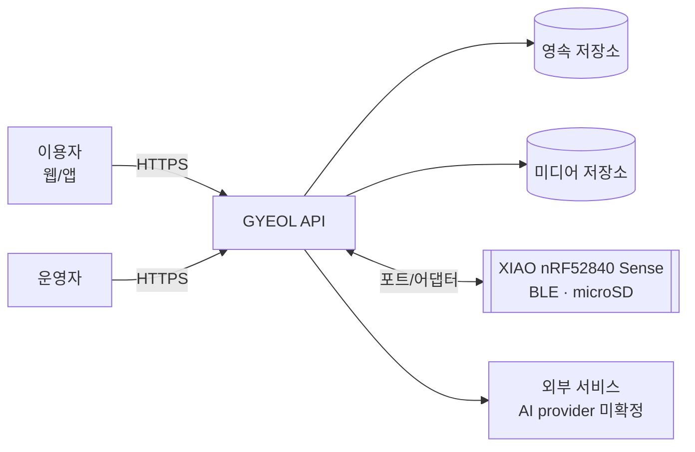
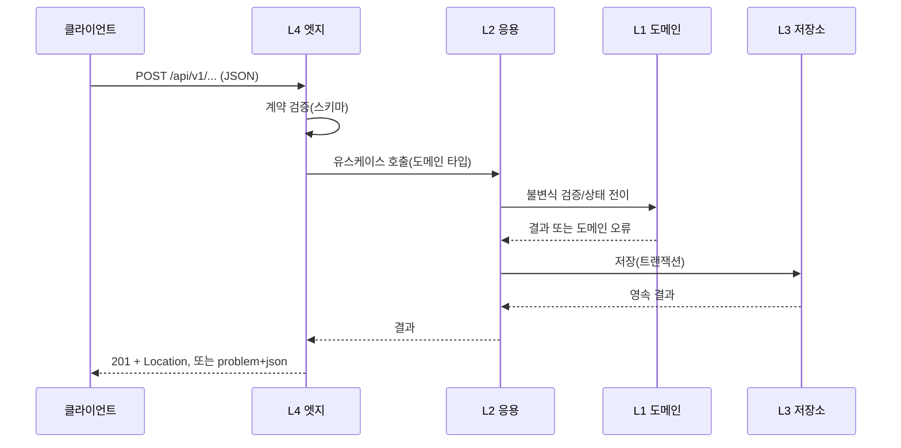

# 시스템 아키텍처 (v0.2)

- 상태: **확정** — `MEMORIAL_PROJECT_SPEC.md` v1.0 (2026-11-13)
- 작성일: 2026-11-13 / 갱신: 2026-11-14
- 관련: `00-repository-analysis.md`, `01-requirements.md`, `contracts/`, `10-domain-model.md`

> 계층 경계와 의존 방향은 확정이다. 구현 진행에 따라 §3 의 "현재 상태" 를 실제 코드와
> 맞춘다. 미확정 사항은 `docs/10-domain-model.md` §10 의 TBD 목록을 따른다.

## 1. 아키텍처 원칙

| # | 원칙 | 근거 |
| --- | --- | --- |
| A1 | 계약 우선(contract-first). 스키마·API 계약이 코드보다 먼저 존재하고 CI로 검증된다. | R-009, RISK-001 |
| A2 | 의존 방향은 항상 **바깥 → 안**. 도메인 코어는 프레임워크/DB/하드웨어를 모른다. | RISK-003 |
| A3 | 하드웨어는 **포트(port) + 어댑터**로만 접근한다. 코어에는 가짜 어댑터를 주입해 테스트한다. | R-011, RISK-002 |
| A4 | 실물 검증 불가 항목은 `HW-PENDING` 으로 분리하고, 소프트웨어 검증 근거와 섞지 않는다. | R-011 |
| A5 | 스키마 변경은 버전과 마이그레이션 절차를 동반한다. | RISK-004 |
| A6 | 최소 수집 원칙. 개인정보 필드는 목적이 확정된 것만 추가한다. | RISK-005 |

## 2. 시스템 컨텍스트



- 확정: API 단일 진입점, 영속 저장소 분리, 미디어 분리, 하드웨어는 교체 가능한 경계 뒤.
- 미확정: AI provider 선택(ENV-05), 인증 방식(D-01).

## 3. 계층 구조

| 계층 | 책임 | 의존 가능 대상 | 현재 상태 |
| --- | --- | --- | --- |
| L0 계약 | JSON Schema, OpenAPI, 오류 코드 | 없음 | **구현됨** (`contracts/`) |
| L1 도메인 코어 | 엔티티, 값 객체, 불변식, 도메인 서비스 | L0 | **구현됨** (`apps/api/src/domain/`) |
| L2 응용 | 유스케이스 오케스트레이션, 트랜잭션 경계 | L1, 포트 인터페이스 | **구현됨** (`apps/api/src/usecases/`) |
| L3 어댑터 | 저장소, 미디어, 하드웨어, 외부 연동 구현 | L1·L2 포트 | **부분 구현** — 메모리 저장소·로컬 디스크·Fake AI. PostgreSQL 어댑터는 W-07 |
| L4 엣지 | HTTP 라우팅, 인증, 요청/응답 매핑, CLI | L2 | **구현됨** (`apps/api/src/http/`) |
| L5 클라이언트 | 웹/앱/장치 UI | L0(계약) | **미착수** — Fake Device/Mobile 은 테스트 하네스(`packages/`) |

**금지 규칙**: L1 은 L2~L5 를 import 하지 않는다. L1·L2 는 하드웨어 SDK/드라이버를
import 하지 않는다. 위반은 CI 린트로 차단한다(스택 확정 후 규칙 구현).

## 4. 하드웨어 경계 설계

하드웨어 경계는 확정됐다(OPEN-003). 포트 정의는 `packages/hardware-adapter/port.ts` 이며,
최소 공통 능력만 노출하고 프로토콜/드라이버 세부는 어댑터 내부에 격리한다.

```text
HardwareAdapter
├─ capture(options): CapturedRecording   // VAD 구간(+전후 버퍼) 녹음
├─ list(): CapturedRecording[]            // ACK 되지 않은 로컬 파일
├─ readFile(clientRecordingId): Buffer
├─ acknowledgeTransfer(clientRecordingId) // 폰 수신 확인 후 기기에서 삭제
└─ status(): WearableStatus               // 배터리·저장공간·대기 파일 수
```

| 규칙 | 내용 |
| --- | --- |
| P1 | 포트는 도메인 타입만 주고받는다. 바이트 배열/프로토콜 프레임은 어댑터 내부에 격리한다. |
| P2 | 포트 구현은 `fake`(테스트), `simulated`(개발), `real`(실물) 3종을 둔다. |
| P3 | `real` 어댑터의 동작은 단위 테스트로 "검증 완료"를 주장하지 않는다 → `HW-PENDING`. |
| P4 | 타임아웃·재시도·서킷브레이커 정책은 어댑터가 아니라 응용 계층에서 결정한다. |

## 5. 데이터 흐름 (쓰기 요청 예)



오류는 L4 에서 HTTP 로, L1·L2 에서는 도메인 오류 타입으로 표현한다. 오류 코드는
`contracts/` 의 코드 레지스트리와 1:1 로 유지한다(`docs/05-api-conventions.md`).

## 6. 품질 속성 (목표 — 스펙 확정 시 수치 조정)

| 속성 | 목표(잠정) | 검증 방법 |
| --- | --- | --- |
| 계약 일관성 | 모든 엔드포인트가 OpenAPI 로 기술되고 CI 통과 | `npm run check` |
| 도메인 격리 | 코어에서 I/O·프레임워크 import 0건 | 의존성 린트 |
| 하드웨어 대체 가능성 | 실물 없이 전체 유스케이스 통합 테스트 통과 | fake 어댑터 통합 테스트 |
| 관측성 | 모든 응답에 `traceId`, 오류에 `code` | 계약 테스트 |
| 복구성 | 상태 확인 엔드포인트가 의존성별 상태 노출 | `/healthz` 계약 |

## 7. 확정 vs 잠정

| 항목 | 구분 | 비고 |
| --- | --- | --- |
| 계층 분리와 의존 방향 | 확정 | 본 문서 A2 |
| 계약 우선 워크플로 | 확정 | CI 구현됨 |
| 오류/problem+json 규약 | 확정 | `contracts/schemas/common/problem.json` |
| 페이지 봉투 | 확정 | `page.json` |
| 하드웨어 포트 존재 | 확정 | `packages/hardware-adapter/port.ts` |
| 언어/런타임/DB/배포 | **확정** (Node/TS, PostgreSQL+pgvector, Object Storage) | 스펙 v1.0 §3 |
| 인증/권한 모델 | **미확정** | D-01 / OPEN-005 |
| 도메인 엔티티 | **확정** | `docs/10-domain-model.md` v1.1 |

## 8. 원본·파생 계층 분리 (Phase 1 확정)

```text
원본 계층   recordings + 오브젝트 스토리지(음성)   ← 불변, 무결성 검증 대상
              │ 1:1
파생 계층   conversations → segments / clusters / entities / actions / embeddings
```

| 규칙 | 내용 |
| --- | --- |
| R1 | 파생 계층은 언제든 삭제·재생성 가능해야 한다(`analysis_version`). |
| R2 | 원본은 `stored`(크기·SHA-256 검증 완료) 이전에 삭제 허가하지 않는다. |
| R3 | 원본 purge 후에도 파생 데이터는 유지할 수 있다(정책 D-11). |
| R4 | 파생 데이터는 `pipeline` 메타데이터로 재현 가능성을 기록한다. |

상세 엔티티·상태 전이·삭제 전파는 `docs/10-domain-model.md` 를 따른다.
