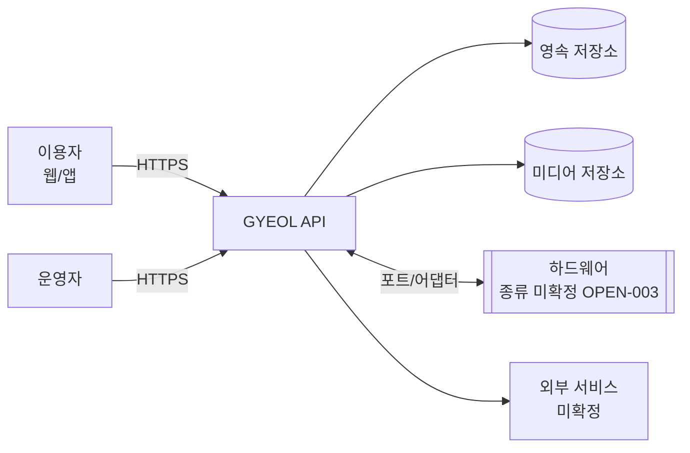
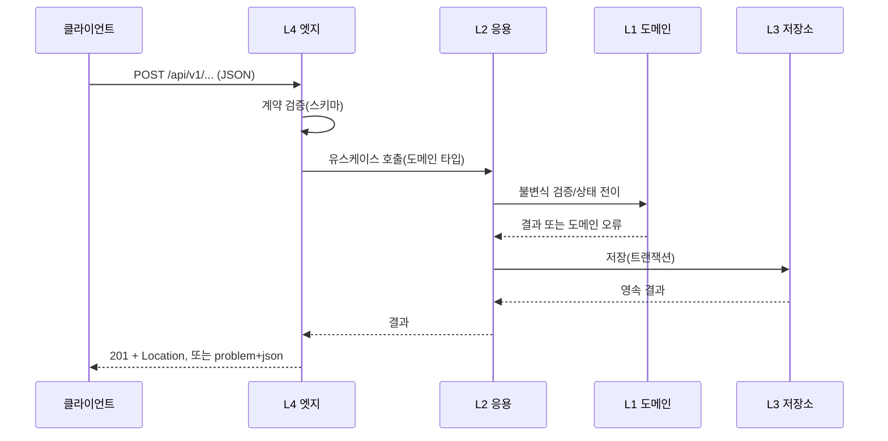

# 시스템 아키텍처 (초안 v0.1)

- 상태: **잠정(provisional)** — `MEMORIAL_PROJECT_SPEC.md` 미확보 (GAP-001)
- 작성일: 2026-11-13
- 관련: `00-repository-analysis.md`, `01-requirements.md`, `contracts/`

> 이 문서는 **기술 중립적 경계**만 확정한다. 언어/프레임워크/DB 선택은 OPEN-002 확정 후
> `adr/` 에 기록하고 본 문서에 반영한다. 확정된 사실과 잠정 가정을 구분해 표기한다.

## 1. 아키텍처 원칙

| # | 원칙 | 근거 |
| --- | --- | --- |
| A1 | 계약 우선(contract-first). 스키마·API 계약이 코드보다 먼저 존재하고 CI로 검증된다. | R-009, RISK-001 |
| A2 | 의존 방향은 항상 **바깥 → 안**. 도메인 코어는 프레임워크/DB/하드웨어를 모른다. | RISK-003 |
| A3 | 하드웨어는 **포트(port) + 어댑터**로만 접근한다. 코어에는 가짜 어댑터를 주입해 테스트한다. | R-011, RISK-002 |
| A4 | 실물 검증 불가 항목은 `HW-PENDING` 으로 분리하고, 소프트웨어 검증 근거와 섞지 않는다. | R-011 |
| A5 | 스키마 변경은 버전과 마이그레이션 절차를 동반한다. | RISK-004 |
| A6 | 최소 수집 원칙. 개인정보 필드는 목적이 확정된 것만 추가한다. | RISK-005 |

## 2. 시스템 컨텍스트



- 확정: API 단일 진입점, 영속 저장소 분리, 미디어 분리, 하드웨어는 교체 가능한 경계 뒤.
- 미확정: 하드웨어 종류·프로토콜, 외부 연동 필요 여부, 인증 방식(OPEN-004).

## 3. 계층 구조

| 계층 | 책임 | 의존 가능 대상 | 현재 상태 |
| --- | --- | --- | --- |
| L0 계약 | JSON Schema, OpenAPI, 오류 코드 | 없음 | **구현됨** (`contracts/`) |
| L1 도메인 코어 | 엔티티, 값 객체, 불변식, 도메인 서비스 | L0 | 미착수 (스펙 필요) |
| L2 응용 | 유스케이스 오케스트레이션, 트랜잭션 경계 | L1, 포트 인터페이스 | 미착수 |
| L3 어댑터 | 저장소, 미디어, 하드웨어, 외부 연동 구현 | L1·L2 포트 | 미착수 |
| L4 엣지 | HTTP 라우팅, 인증, 요청/응답 매핑, CLI | L2 | 미착수 |
| L5 클라이언트 | 웹/앱/장치 UI | L0(계약) | 미착수 |

**금지 규칙**: L1 은 L2~L5 를 import 하지 않는다. L1·L2 는 하드웨어 SDK/드라이버를
import 하지 않는다. 위반은 CI 린트로 차단한다(스택 확정 후 규칙 구현).

## 4. 하드웨어 경계 설계

하드웨어 종류가 미확정이므로, **최소 공통 능력**만 포트로 정의하고 나머지는 확장한다.

```text
DevicePort
├─ describe(): DeviceDescriptor        // 식별/펌웨어/능력
├─ health(): DeviceHealth              // 연결 상태, 지연
├─ read(command): DeviceReading        // 센서/입력 읽기
└─ write(command, payload): Ack        // 표시/구동 (지원 시)
```

| 규칙 | 내용 |
| --- | --- |
| P1 | 포트는 도메인 타입만 주고받는다. 바이트 배열/프로토콜 프레임은 어댑터 내부에 격리한다. |
| P2 | 포트 구현은 `fake`(테스트), `simulated`(개발), `real`(실물) 3종을 둔다. |
| P3 | `real` 어댑터의 동작은 단위 테스트로 "검증 완료"를 주장하지 않는다 → `HW-PENDING`. |
| P4 | 타임아웃·재시도·서킷브레이커 정책은 어댑터가 아니라 응용 계층에서 결정한다. |

> OPEN-003 확정 시 `DevicePort` 를 capability 단위로 분리한다(예: 표시, 입력, 근접 감지).

## 5. 데이터 흐름 (쓰기 요청 예)



오류는 L4 에서 HTTP 로, L1·L2 에서는 도메인 오류 타입으로 표현한다. 오류 코드는
`contracts/` 의 코드 레지스트리와 1:1 로 유지한다(`docs/05-api-conventions.md`).

## 6. 품질 속성 (목표 — 스펙 확정 시 수치 조정)

| 속성 | 목표(잠정) | 검증 방법 |
| --- | --- | --- |
| 계약 일관성 | 모든 엔드포인트가 OpenAPI 로 기술되고 CI 통과 | `npm run check` |
| 도메인 격리 | 코어에서 I/O·프레임워크 import 0건 | 의존성 린트 |
| 하드웨어 대체 가능성 | 실물 없이 전체 유스케이스 통합 테스트 통과 | fake 어댑터 통합 테스트 |
| 관측성 | 모든 응답에 `traceId`, 오류에 `code` | 계약 테스트 |
| 복구성 | 상태 확인 엔드포인트가 의존성별 상태 노출 | `/healthz` 계약 |

## 7. 확정 vs 잠정

| 항목 | 구분 | 비고 |
| --- | --- | --- |
| 계층 분리와 의존 방향 | 확정 | 본 문서 A2 |
| 계약 우선 워크플로 | 확정 | CI 구현됨 |
| 오류/problem+json 규약 | 확정 | `contracts/schemas/common/problem.json` |
| 페이지 봉투 | 확정 | `page.json` |
| 하드웨어 포트 존재 | 확정 | 상세 capability 는 미확정 |
| 언어/런타임/DB/배포 | **미확정** | OPEN-002 |
| 인증/권한 모델 | **미확정** | OPEN-004 |
| 도메인 엔티티 | **미확정** | OPEN-001 |
