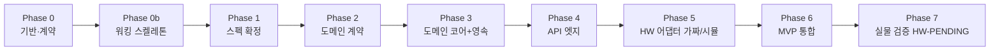

# 단계별 개발 계획 (v0.1)

- 기준: `01-requirements.md` (R-001~R-014)
- 규칙: 각 단계는 **테스트 근거 + 문서 갱신**이 있어야 완료다(R-010).
  실물 하드웨어에서만 확인 가능한 항목은 완료로 표시하지 않고 `HW-PENDING` 으로 넘긴다(R-011).

## 0. 전체 흐름

## Phase 0 — 기반 구축 (완료)

| 항목 | 내용 |
| --- | --- |
| 목표 | 스펙과 무관하게 유효한 개발 기반 확립 |
| 산출물 | 저장소 분석서, 요구사항 기준선, 아키텍처/폴더/API 규약, 공통 스키마 3종, OpenAPI 골격, 계약 검증기, 테스트 2건, CI, Makefile |
| 완료 조건 | `npm run check` 통과 (스키마 3 · 예제 5 · OpenAPI 유효) |
| 상태 | **완료** — 근거: `tools/test/contracts.test.mjs` 실행 로그 |
| 비고 | 도메인 엔티티는 스펙 부재로 의도적으로 만들지 않음 |

## Phase 0b — 워킹 스켈레톤 (완료)

| 항목 | 내용 |
| --- | --- |
| 목표 | 계약 → 구현 → 계약 테스트의 왕복이 실제로 동작함을 증명 |
| 산출물 | `apps/api/server.mjs`(`/healthz`, `/api/v1/info`, problem+json 404/405), `tools/contract-test.mjs`(블랙박스 계약 검증), API 테스트 4건 |
| 완료 조건 | `npm run check` 통과 (테스트 6건) + 계약 위반 주입 시 테스트 실패 확인 |
| 상태 | **완료** — 근거: `tools/test/api.test.mjs` 실행 로그 |
| 비고 | 프레임워크 미사용. 스택 확정 시 L4 만 교체하면 된다. 도메인 로직 없음. |

## Phase 1 — 스펙 확정 (대기)

| 항목 | 내용 |
| --- | --- |
| 목표 | `MEMORIAL_PROJECT_SPEC.md` 확정 및 OPEN-001~006 해소 |
| 선행 | 사용자 입력 |
| 산출물 | 확정된 기준 문서, 갱신된 요구사항 추적표, ADR(스택/인증/데이터 보존) |
| 완료 조건 | OPEN-001~004 가 모두 결정되고 문서에 반영됨 |
| 상태 | **BLOCKED** |
| 리스크 | 미해소 시 이후 모든 단계가 추정 설계가 됨 (RISK-001) |

## Phase 2 — 도메인 계약·데이터 모델

| 항목 | 내용 |
| --- | --- |
| 목표 | 핵심 엔티티/값 객체/불변식을 스키마와 문서로 확정 |
| 선행 | Phase 1 |
| 산출물 | `contracts/schemas/domain/*.json`, ERD, 마이그레이션 정책, 오류 코드 확장 |
| 테스트 | 스키마 valid/invalid 예제, 제약(필수/길이/열거) 커버리지 |
| 완료 조건 | 모든 엔티티에 스키마+예제+문서, `npm run check` 통과 |
| 상태 | TODO |

## Phase 3 — 도메인 코어 + 영속 어댑터

| 항목 | 내용 |
| --- | --- |
| 목표 | 순수 도메인 로직과 저장소 구현 |
| 선행 | Phase 2, 스택 확정(OPEN-002) |
| 산출물 | L1 도메인 패키지, L2 유스케이스, L3 영속 어댑터, 마이그레이션 |
| 테스트 | 도메인 단위 테스트(불변식/상태 전이), 저장소 통합 테스트(컨테이너) |
| 완료 조건 | 핵심 유스케이스가 저장소 통합 테스트로 통과, 커버리지 목표 합의 |
| 상태 | TODO |

## Phase 4 — API 엣지

| 항목 | 내용 |
| --- | --- |
| 목표 | OpenAPI 계약과 구현의 일치 |
| 선행 | Phase 3 |
| 산출물 | L4 HTTP 서버, 요청 검증, problem+json 매핑, `/healthz`, `/api/v1/info` |
| 테스트 | 계약 테스트(응답이 스키마 통과), 오류 경로 테스트(400/404/409/422/500) |
| 완료 조건 | 모든 엔드포인트 계약 테스트 통과 + OpenAPI 와 diff 없음 |
| 상태 | TODO |

## Phase 5 — 하드웨어 어댑터 (가짜/시뮬레이터)

| 항목 | 내용 |
| --- | --- |
| 목표 | 실물 없이 하드웨어 의존 흐름 전체 검증 |
| 선행 | OPEN-003, Phase 4 |
| 산출물 | `DevicePort` 구현 3종 중 fake/simulated, 장애 주입(지연/단절/오류) |
| 테스트 | 타임아웃·재시도·서킷브레이커, 단절 시 503 및 `healthz` 반영 |
| 완료 조건 | 실물 없이 E2E 시나리오 통과 |
| 상태 | TODO |

## Phase 6 — MVP 통합

| 항목 | 내용 |
| --- | --- |
| 목표 | MVP 범위 수용 기준 충족 |
| 선행 | Phase 5 |
| 산출물 | 데모 시나리오, 운영 문서, 릴리스 체크리스트, 백업/복구 절차 |
| 테스트 | 수용 테스트(스펙 기준), 부하/지연 목표 확인 |
| 완료 조건 | 스펙의 MVP 수용 기준 전부 통과 |
| 상태 | TODO |

## Phase 7 — 실물 하드웨어 검증

| 항목 | 내용 |
| --- | --- |
| 목표 | 실기 동작 확인 |
| 산출물 | HW 검증 시나리오, 측정 기록(지연/오류율/전원), `HW-PENDING` 해소표 |
| 완료 조건 | `HW-PENDING` 항목이 실측 근거와 함께 닫힘 |
| 상태 | **미착수** — 실물 미확보 |

> Phase 7 전까지 하드웨어 관련 기능은 어떤 문서에서도 "완료"로 표기하지 않는다.

## 1. 작업 단위 규칙

1. 한 작업 = 한 커밋. 커밋 메시지에 요구사항 ID 를 남긴다(`feat(R-009): ...`).
2. 코드 변경 시 해당 문서를 같은 커밋에서 갱신한다.
3. 계약 변경 시 예제(valid/invalid)를 함께 갱신한다 — 검증기가 강제한다.
4. 삭제가 필요하면 사유를 ADR 또는 커밋 본문에 기록한다(R-012).
