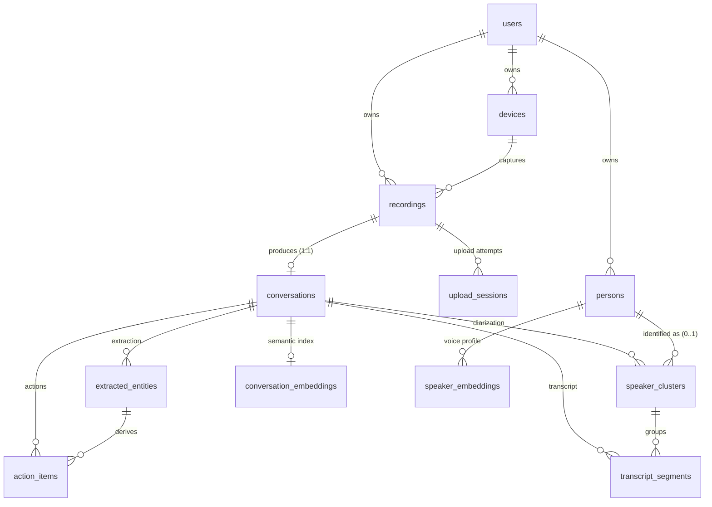

# Phase 1 도메인 모델 및 ERD (설계안 v1.0 — 승인 요청)

- 상태: **검토 대기** (승인 후 마이그레이션·코드 생성)
- 기준 문서: `MEMORIAL_PROJECT_SPEC.md` v1.0
- 범위: 서버(PostgreSQL) 도메인. iOS 로컬 DB·펌웨어 저장소는 §7 에 별도 기술.

---

## 1. 설계 원칙

| # | 원칙 | 구현 방식 |
| --- | --- | --- |
| P1 | 원본(raw)과 분석(derived)의 생명주기 분리 | `recordings`(+오브젝트) vs `conversations` 이하. 파생 데이터만 삭제·재생성 가능 |
| P2 | 원본은 검증 전 삭제 불가 | `recording.status` 가 `stored`(무결성 검증 완료)가 되기 전 클라이언트에 삭제 허가를 주지 않는다. 서버는 ACK 를 `verified_at` 으로만 발행 |
| P3 | 분석은 재현 가능해야 한다 | `conversations.pipeline` 에 provider/model/version 기록, `analysis_version` 증가 |
| P4 | 불확실한 화자는 사람으로 승격하지 않는다 | `speaker_clusters.person_id = NULL` + `identification_status='unknown'` |
| P5 | 멱등 업로드 | `recordings(device_id, client_recording_id)` 유니크 + 업로드 세션 오프셋 |
| P6 | 시각은 UTC | 모든 `timestamptz`. 기기 로컬 시각은 오프셋만 별도 보관 |
| P7 | 확정 불가는 TBD | §10 참조. 임의 값으로 스키마를 굳히지 않는다 |

### 1.1 식별자·타입 규칙

- PK: `uuid` (UUIDv7 — 시간순 정렬 가능, B-tree 지역성). 애플리케이션에서 생성.
- 시각: `timestamptz`, 기본값 `now()`. 외부 입력은 RFC 3339 UTC.
- 열거형: PostgreSQL `ENUM` 대신 `text + CHECK` — 값 추가 시 잠금 없는 마이그레이션이 쉽다.
- 신뢰도: `numeric(4,3)` (0.000~1.000).
- 삭제: soft delete(`deleted_at`) + 별도 purge. 하드 삭제는 보존 정책 작업에서만.

---

## 2. ERD



읽는 법:

- `recordings` 는 1:1 로 `conversations` 를 만든다. 분석 실패 시 conversation 은 없고
  `recording.status` 로 실패를 표현한다(빈 껍데기 행을 만들지 않는다).
- 화자 식별은 `speaker_clusters.person_id` 로 연결한다. `persons` 는 **식별된 사람만**
  보관하므로, 미확인 화자는 person 행을 만들지 않는다(D-03 승인 필요).
- 인물↔대화는 다대다이며 `speaker_clusters` 가 연결 테이블 역할을 한다.

---

## 3. 엔티티 정의

### 3.1 `users`

| 필드 | 타입 | NULL | 제약/기본 | 설명 |
| --- | --- | --- | --- | --- |
| `id` | uuid | N | PK | UUIDv7 |
| `auth_subject` | text | Y | UNIQUE | IdP subject. 인증 방식 TBD(D-01) |
| `email` | citext | Y | UNIQUE | 알림·연락용. 로그인 수단으로 단정하지 않음 |
| `display_name` | text | N | length 1..80 | 표시 이름 |
| `locale` | text | N | `'ko-KR'` | UI 언어 |
| `timezone` | text | N | `'Asia/Seoul'` | IANA 이름 |
| `status` | text | N | `'active'` CHECK IN (`active`,`suspended`,`deleted`) | 계정 상태 |
| `created_at` | timestamptz | N | `now()` | |
| `updated_at` | timestamptz | N | `now()` | |
| `deleted_at` | timestamptz | Y | | soft delete |

- 인덱스: `unique(auth_subject)`, `unique(email)`, `(status)`
- TBD: 초대 기반 가입인지, 다중 사용자(가족 공유) 지원 여부(D-08)

### 3.2 `devices`

| 필드 | 타입 | NULL | 제약/기본 | 설명 |
| --- | --- | --- | --- | --- |
| `id` | uuid | N | PK | |
| `user_id` | uuid | Y | FK → users, ON DELETE SET NULL | 미등록(공장 초기) 기기 허용 |
| `serial_no` | text | N | UNIQUE | 펌웨어 고유 번호 |
| `model` | text | N | `'xiao-nrf52840-sense'` | 하드웨어 모델 |
| `hardware_revision` | text | Y | | 리비전 |
| `firmware_version` | text | Y | | 보고된 버전 |
| `lifecycle_status` | text | N | `'provisioned'` CHECK IN (`provisioned`,`active`,`retired`) | 기기 수명주기 |
| `last_seen_at` | timestamptz | Y | | 마지막 통신 |
| `battery_pct` | smallint | Y | CHECK 0..100 | 최근 텔레메트리 |
| `storage_free_bytes` | bigint | Y | CHECK ≥ 0 | microSD 여유 |
| `config` | jsonb | N | `'{}'` | VAD 임계값 등 기기 설정(D-09) |
| `created_at` | timestamptz | N | `now()` | |
| `updated_at` | timestamptz | N | `now()` | |

- **연결 상태는 저장하지 않는다**: `last_seen_at` 과 TTL 로 파생(`online`/`offline`/`unknown`).
  저장하면 갱신 실패 시 거짓 상태가 남는다.
- 인덱스: `unique(serial_no)`, `(user_id)`, `(last_seen_at)`

### 3.3 `recordings` (원본 계층)

| 필드 | 타입 | NULL | 제약/기본 | 설명 |
| --- | --- | --- | --- | --- |
| `id` | uuid | N | PK | |
| `user_id` | uuid | N | FK → users | 조회 범위 |
| `device_id` | uuid | N | FK → devices | |
| `client_recording_id` | text | N | UNIQUE(device_id, ·) | 펌웨어 생성 ID(멱등 키) |
| `device_seq` | bigint | Y | | 기기 내 순번(정렬 보조) |
| `started_at` | timestamptz | N | | 녹음 시작(UTC 환산) |
| `ended_at` | timestamptz | N | CHECK > started_at | |
| `captured_offset_min` | smallint | Y | CHECK -840..840 | 기기 로컬 오프셋(표시용) |
| `duration_ms` | integer | N | CHECK > 0 | |
| `codec` | text | N | CHECK IN (`wav_pcm_s16le`,`opus_ogg`) | D-04 |
| `sample_rate_hz` | integer | N | CHECK > 0 | 후보: 16000 |
| `channels` | smallint | N | CHECK > 0 | 후보: 1 |
| `byte_size` | bigint | N | CHECK > 0 | 원본 크기 |
| `sha256` | char(64) | N | CHECK `^[0-9a-f]{64}$` | 무결성 기준값(클라이언트 산출) |
| `storage_key` | text | Y | | 오브젝트 스토리지 키. purge 시 NULL |
| `status` | text | N | `'initiated'` CHECK (§6.2) | |
| `vad` | jsonb | Y | | VAD 파라미터·구간 수 등 |
| `uploaded_at` | timestamptz | Y | | 마지막 바이트 수신 완료 |
| `verified_at` | timestamptz | Y | | 무결성 검증 완료 (= 클라이언트 삭제 허가 시점) |
| `analyzed_at` | timestamptz | Y | | 분석 완료 |
| `purged_at` | timestamptz | Y | | 원본 오디오 삭제 완료 |
| `created_at` / `updated_at` | timestamptz | N | `now()` | |
| `deleted_at` | timestamptz | Y | | |

- 인덱스: `unique(device_id, client_recording_id)`, `(user_id, started_at DESC)`,
  `(status)`, `(device_id, status)`
- 중복 콘텐츠(`sha256`)는 **유니크로 강제하지 않는다** — 의도적 중복 녹음 가능.
- `storage_key` 는 검증 전에도 존재할 수 있다(부분 업로드 임시 키는 세션에 기록).

### 3.4 `upload_sessions`

| 필드 | 타입 | NULL | 제약/기본 | 설명 |
| --- | --- | --- | --- | --- |
| `id` | uuid | N | PK | |
| `recording_id` | uuid | N | FK → recordings ON DELETE CASCADE | |
| `status` | text | N | `'open'` CHECK (`open`,`completed`,`aborted`,`expired`) | |
| `expected_bytes` | bigint | N | CHECK > 0 | |
| `received_bytes` | bigint | N | `0` CHECK 0 ≤ · ≤ expected | 재개 오프셋 |
| `expected_sha256` | char(64) | N | | |
| `chunk_size_bytes` | integer | N | CHECK > 0 | D-06 |
| `expires_at` | timestamptz | N | | 미완료 세션 정리 |
| `completed_at` | timestamptz | Y | | |
| `created_at` / `updated_at` | timestamptz | N | `now()` | |

- 부분 유니크 인덱스: `unique(recording_id) WHERE status='open'` — 동시 세션 1개.
- 바이트 자체는 오브젝트 스토리지 임시 키에 append. DB 에는 오프셋만.
- 이어받기: 클라이언트가 `received_bytes` 를 조회해 그 지점부터 전송.

### 3.5 `conversations` (분석 계층 루트)

| 필드 | 타입 | NULL | 제약/기본 | 설명 |
| --- | --- | --- | --- | --- |
| `id` | uuid | N | PK | |
| `recording_id` | uuid | N | UNIQUE, FK → recordings | 1:1 |
| `user_id` | uuid | N | FK → users | |
| `title` | text | Y | length ≤ 200 | AI 생성 제목 |
| `summary` | text | Y | | 요약 |
| `language` | text | N | `'ko'` | BCP-47 |
| `started_at` / `ended_at` | timestamptz | N | | 세그먼트 범위에서 산출 |
| `analysis_version` | integer | N | `1` | 재분석 시 증가 |
| `status` | text | N | `'ready'` CHECK (`ready`,`partial`) | 일부 단계 실패는 `partial` |
| `pipeline` | jsonb | N | `'{}'` | provider/model/version/stage 결과 |
| `created_at` / `updated_at` | timestamptz | N | `now()` | |
| `deleted_at` | timestamptz | Y | | 분석 결과만 삭제(원본 유지) |

- 인덱스: `unique(recording_id)`, `(user_id, started_at DESC)`
- 재분석: 기존 행을 UPDATE 하고 `analysis_version++`. 이력 보관은 TBD(D-10).

### 3.6 `speaker_clusters`

| 필드 | 타입 | NULL | 제약/기본 | 설명 |
| --- | --- | --- | --- | --- |
| `id` | uuid | N | PK | |
| `conversation_id` | uuid | N | FK ON DELETE CASCADE | |
| `label` | text | N | UNIQUE(conversation_id, label) | `SPEAKER_1` 등 표시용 |
| `person_id` | uuid | Y | FK → persons ON DELETE SET NULL | NULL = Unknown |
| `identification_status` | text | N | `'unknown'` CHECK (`unknown`,`suggested`,`confirmed`) | |
| `confidence` | numeric(4,3) | Y | CHECK 0..1 | 식별 신뢰도 |
| `created_at` / `updated_at` | timestamptz | N | `now()` | |

> "Unknown Speaker" 를 별도 person 행으로 만들지 않는 이유: 대화마다 생겨 사람 목록이
> 오염되고, 나중에 동일인으로 병합할 근거도 없다. 표시는 `label` 로 충분하다.

### 3.7 `transcript_segments`

| 필드 | 타입 | NULL | 제약/기본 | 설명 |
| --- | --- | --- | --- | --- |
| `id` | uuid | N | PK | |
| `conversation_id` | uuid | N | FK ON DELETE CASCADE | |
| `seq` | integer | N | UNIQUE(conversation_id, seq) | 정렬 |
| `start_ms` / `end_ms` | integer | N | CHECK end > start | 녹음 시작 기준 |
| `text` | text | N | | 발화 내용 |
| `speaker_cluster_id` | uuid | Y | FK → speaker_clusters ON DELETE SET NULL | 분리 실패 허용 |
| `confidence` | numeric(4,3) | Y | CHECK 0..1 | STT 신뢰도 |
| `created_at` | timestamptz | N | `now()` | |

- 검색용 `tsvector` 파생 컬럼/인덱스는 D-07 확정 후 추가.

### 3.8 `persons`

| 필드 | 타입 | NULL | 제약/기본 | 설명 |
| --- | --- | --- | --- | --- |
| `id` | uuid | N | PK | |
| `user_id` | uuid | N | FK → users | |
| `display_name` | text | N | length 1..80 | 사용자가 지정 |
| `notes` | text | Y | | |
| `merged_into_person_id` | uuid | Y | FK → persons, CHECK ≠ id | 중복 인물 병합 |
| `created_at` / `updated_at` | timestamptz | N | `now()` | |
| `deleted_at` | timestamptz | Y | | |

- 인덱스: `(user_id, display_name)`, `(merged_into_person_id)`

### 3.9 `speaker_embeddings` (민감 — 음성 생체 정보)

| 필드 | 타입 | NULL | 제약/기본 | 설명 |
| --- | --- | --- | --- | --- |
| `id` | uuid | N | PK | |
| `person_id` | uuid | Y | FK ON DELETE CASCADE | 식별된 사람의 프로필 |
| `speaker_cluster_id` | uuid | Y | FK ON DELETE CASCADE | 대화 내 클러스터 |
| `provider` / `model` | text | N | | 임베딩 생성기 |
| `dim` | smallint | N | CHECK > 0 | D-05 |
| `embedding` | vector(N) | N | | N 은 D-05 확정 후 고정 |
| `quality` | numeric(4,3) | Y | CHECK 0..1 | |
| `created_at` | timestamptz | N | `now()` | |

- CHECK: `person_id IS NOT NULL OR speaker_cluster_id IS NOT NULL`
- 인덱스: `(person_id)`, `(speaker_cluster_id)`, HNSW/IVFFlat 인덱스는 차원 확정 후.
- 보존: 사람 삭제 시 함께 삭제. 원본 오디오 삭제와 별개(D-11).

### 3.10 `extracted_entities`

| 필드 | 타입 | NULL | 제약/기본 | 설명 |
| --- | --- | --- | --- | --- |
| `id` | uuid | N | PK | |
| `conversation_id` | uuid | N | FK ON DELETE CASCADE | |
| `segment_id` | uuid | Y | FK → transcript_segments ON DELETE SET NULL | 근거 발화 |
| `kind` | text | N | CHECK (`person`,`place`,`event`,`appointment`,`task`,`other`) | |
| `value` | text | N | | 원문 표기 |
| `normalized_value` | text | Y | | 정규화(장소명 등) |
| `confidence` | numeric(4,3) | Y | CHECK 0..1 | |
| `created_at` | timestamptz | N | `now()` | |

- 인덱스: `(conversation_id, kind)`, `(normalized_value)`

### 3.11 `action_items`

| 필드 | 타입 | NULL | 제약/기본 | 설명 |
| --- | --- | --- | --- | --- |
| `id` | uuid | N | PK | |
| `conversation_id` | uuid | N | FK ON DELETE CASCADE | |
| `entity_id` | uuid | Y | FK → extracted_entities ON DELETE SET NULL | 추출 근거 |
| `title` | text | N | length 1..200 | |
| `due_at` | timestamptz | Y | | |
| `status` | text | N | `'open'` CHECK (`open`,`done`,`dismissed`) | |
| `confidence` | numeric(4,3) | Y | CHECK 0..1 | |
| `created_at` / `updated_at` | timestamptz | N | `now()` | |
| `completed_at` | timestamptz | Y | | |

- 인덱스: `(conversation_id, status)`, 부분 인덱스 `(due_at) WHERE status='open'`

### 3.12 `conversation_embeddings`

| 필드 | 타입 | NULL | 제약/기본 | 설명 |
| --- | --- | --- | --- | --- |
| `id` | uuid | N | PK | |
| `conversation_id` | uuid | N | UNIQUE, FK ON DELETE CASCADE | |
| `provider` / `model` | text | N | | |
| `dim` | smallint | N | CHECK > 0 | D-05 |
| `embedding` | vector(N) | N | | |
| `created_at` | timestamptz | N | `now()` | |

---

## 4. 관계 요약

| 관계 | 카디널리티 | 삭제 정책 |
| --- | --- | --- |
| users → devices | 1:N | SET NULL (기기는 이력 보존) |
| users → recordings | 1:N | RESTRICT (계정 삭제는 purge 절차 후) |
| users → persons | 1:N | CASCADE |
| devices → recordings | 1:N | RESTRICT |
| recordings → upload_sessions | 1:N | CASCADE |
| recordings → conversations | 1:1 | CASCADE (파생 삭제) |
| conversations → speaker_clusters / segments / entities / actions / embedding | 1:N | CASCADE |
| speaker_clusters → transcript_segments | 1:N | SET NULL |
| persons → speaker_clusters | 1:N (0..1 연결) | SET NULL + `identification_status='unknown'` |
| persons → speaker_embeddings | 1:N | CASCADE |
| extracted_entities → action_items | 1:N | SET NULL |

---

## 5. 인덱스 설계 요약

| 목적 | 인덱스 |
| --- | --- |
| 날짜별 대화 | `conversations(user_id, started_at DESC)` |
| 기기별 미동기화 | `recordings(device_id, status)` |
| 멱등 업로드 | `unique(device_id, client_recording_id)` |
| 열린 세션 1개 | `unique(recording_id) WHERE status='open'` |
| 인물별 기록 | `speaker_clusters(person_id)`, `(conversation_id)` |
| 할 일 | `action_items(conversation_id, status)` |
| 의미 검색 | 벡터 인덱스 — D-05 확정 후 (`hnsw` 우선 검토) |

---

## 6. 상태 전이표

### 6.1 `device.lifecycle_status`

| 현재 | 이벤트 | 가드 | 다음 | 부수효과 |
| --- | --- | --- | --- | --- |
| `provisioned` | 사용자 등록/최초 연결 | `user_id` 설정됨 | `active` | `last_seen_at` 갱신 |
| `active` | 분실/폐기 | 사용자 요청 | `retired` | 수집 중단, 데이터는 유지 |
| `retired` | 재등록 | 사용자 요청 | `active` | — |
| `active` | 텔레메트리 수신 | — | `active` | `last_seen_at`, `battery_pct` 갱신 |

연결 상태(파생): `now - last_seen_at ≤ TTL` → `online`, 초과 → `offline`, `last_seen_at IS NULL` → `unknown`.

### 6.2 `recording.status` (원본)

| 현재 | 이벤트 | 가드 | 다음 | 부수효과 |
| --- | --- | --- | --- | --- |
| `initiated` | 첫 청크 수신 | 세션 `open`, 오프셋 일치 | `uploading` | `upload_sessions.received_bytes` 증가 |
| `uploading` | 추가 청크 | 오프셋 일치 | `uploading` | 이어받기 지점 갱신 |
| `uploading` | 전송 완료 | `received == expected` | (검증 단계) | SHA-256·크기 대조 |
| (검증) | 검증 성공 | 해시·크기 일치 | `stored` | `verified_at=now()`, 세션 `completed` |
| (검증) | 검증 실패 | 불일치 | `integrity_failed` | 임시 바이트 폐기, 세션 `aborted` |
| `integrity_failed` | 재업로드 시작 | 새 세션 발급 | `initiated` | `expected_*` 재설정 가능 |
| `stored` | 분석 요청 | 세션 `completed` | `analyzing` | 파이프라인 시작 |
| `analyzing` | 성공 | conversation 생성됨 | `analyzed` | `analyzed_at` |
| `analyzing` | 실패 | — | `analysis_failed` | 오류 기록 |
| `analysis_failed` | 재시도 | — | `analyzing` | 시도 횟수 증가 |
| `analyzed` | 재분석 | 사용자 요청 | `analyzing` | `analysis_version++` |
| `stored`/`analyzed` | 보존 만료·사용자 삭제 | — | `purged` | 오디오 삭제, `storage_key=NULL`, `purged_at` |
| 임의 | 사용자 삭제 | — | (변경 없음) | `deleted_at` 설정, 조회 제외 |

> `deleted_at` 은 상태가 아니라 가시성 플래그다. purge 와 별개로 동작한다.
> **`stored` 이전에는 클라이언트에 삭제 허가를 내리지 않는다(P2).**

### 6.3 `upload_session.status`

| 현재 | 이벤트 | 가드 | 다음 | 부수효과 |
| --- | --- | --- | --- | --- |
| `open` | 청크 append | `offset == received_bytes` | `open` | `received_bytes` 증가 |
| `open` | 마지막 청크 + 검증 성공 | 해시·크기 일치 | `completed` | `completed_at`, recording `stored` |
| `open` | 검증 실패 | 불일치 | `aborted` | 임시 바이트 폐기 |
| `open` | 클라이언트 중단 | — | `aborted` | — |
| `open` | 만료 시각 경과 | `now > expires_at` | `expired` | 임시 바이트 정리 작업 |

### 6.4 `conversation.status`

| 현재 | 이벤트 | 가드 | 다음 | 부수효과 |
| --- | --- | --- | --- | --- |
| — | 파이프라인 성공 | 모든 필수 단계 성공 | `ready` | conversation 생성 |
| — | 일부 단계 실패 | 요약은 생성됨 | `partial` | `pipeline` 에 실패 단계 기록 |
| `partial` | 재분석 성공 | — | `ready` | `analysis_version++` |
| `ready` | 재분석 | — | `ready` | `analysis_version++`, 하위 데이터 교체 |

### 6.5 `speaker_cluster.identification_status`

| 현재 | 이벤트 | 가드 | 다음 | 부수효과 |
| --- | --- | --- | --- | --- |
| `unknown` | 유사도 ≥ 제안 임계값 | 후보 person 존재 | `suggested` | `person_id` 후보 설정, `confidence` 기록 |
| `unknown` | 사용자 직접 지정 | — | `confirmed` | `person_id` 설정 |
| `suggested` | 사용자 확인 | — | `confirmed` | — |
| `suggested` | 사용자 거부 | — | `unknown` | `person_id=NULL` |
| `confirmed` | 사용자 해제 | — | `unknown` | `person_id=NULL` |

> 임계값·후보 생성 규칙은 D-12. 어떤 경우에도 자동으로 `confirmed` 가 되지 않는다.

### 6.6 `action_item.status`

| 현재 | 이벤트 | 다음 | 부수효과 |
| --- | --- | --- | --- |
| `open` | 완료 | `done` | `completed_at` |
| `open` | 무시 | `dismissed` | — |
| `done` | 되돌리기 | `open` | `completed_at=NULL` |
| `dismissed` | 되돌리기 | `open` | — |

### 6.7 `person` 병합

| 현재 | 이벤트 | 가드 | 다음 | 부수효과 |
| --- | --- | --- | --- | --- |
| active | 병합 요청 | 대상 ≠ 자기 자신 | `merged` | `speaker_clusters.person_id` 이전, `merged_into_person_id` 설정, `deleted_at` |

---

## 7. 클라이언트(폰/펌웨어) 로컬 상태 — 서버 DB 아님

"원본은 검증 전 삭제 금지"를 실제로 보장하는 곳은 폰 로컬 원장이다. 서버 계약과 같은
개념(오프셋·해시·ACK)을 쓰도록 맞춘다.

```text
[웨어러블]  recorded → transfer_ready → transferring(offset) → transferred
[폰]        received → uploading(offset) → uploaded → server_acked(= verified_at) → deletable
```

| 상태 | 삭제 가능? | 근거 |
| --- | --- | --- |
| `recorded` | 불가 | 아직 전송 전 |
| `transferring` | 불가 | 부분 전송 |
| `transferred` | 불가 | 서버 업로드 전 |
| `uploading` | 불가 | 부분 업로드 |
| `uploaded` | **불가** | 서버 검증 전 |
| `server_acked` | 가능 | 서버가 무결성 검증 완료(`verified_at`) |

- BLE 재연결 시 `offset` 부터 재전송. 웨어러블은 ACK 받은 바이트까지만 삭제.
- 서버 API 는 `GET /recordings/{id}` 응답에 `verifiedAt` 과 `nextOffset` 을 제공해
  폰이 삭제 시점을 판단하게 한다.

---

## 8. 데이터 생명주기

```text
[수집] 웨어러블 VAD 녹음 → microSD
   ↓ BLE (오프셋/ACK)
[전달] 폰 로컬 저장 (삭제 금지 구간)
   ↓ HTTPS (재개 가능 업로드)
[검증] 서버: 크기·SHA-256 일치 → recordings.status='stored', verified_at
   ↓ (이 시점에만 폰 삭제 허가)
[분석] STT → 화자분리 → 식별 → 대화구성 → 요약 → 추출 → 임베딩
   ↓
[파생] conversations 이하 (원본과 분리 저장, 재생성 가능)
   ↓
[보존] 정책에 따라 원본 purge / 파생만 삭제 / 전체 삭제 / 내보내기
```

### 8.1 삭제 전파표

| 요청 | recordings | conversations 이하 | 오브젝트 | 비고 |
| --- | --- | --- | --- | --- |
| 파생 데이터만 삭제 | 유지 | 삭제 | 유지 | 재분석 가능 |
| 원본 삭제(보존 만료) | `purged` | 유지 | 삭제 | 요약·검색은 남음(D-11) |
| 녹음 전체 삭제 | soft delete + purge | CASCADE 삭제 | 삭제 | 되돌릴 수 없음 |
| 인물 삭제 | 유지 | 클러스터 `person_id=NULL` | 유지 | 임베딩 삭제 |
| 계정 삭제 | 전부 purge | 전부 purge | 전부 삭제 | 절차 후 실행 |

### 8.2 재분석

`analysis_version` 을 올리고 파생 데이터를 **교체**한다(append 하지 않는다).
원본이 `purged` 면 재분석 불가 → `409 CONFLICT` + `code=SOURCE_PURGED`(오류 코드 추가 예정).

---

## 9. 보안·개인정보 (설계 반영, 세부는 TBD)

| 항목 | 설계 |
| --- | --- |
| 전송 구간 | TLS 필수. 업로드 URL 은 짧은 만료의 서명 URL |
| 저장 암호화 | 오브젝트 스토리지 SSE. DB 컬럼 암호화 범위 TBD(D-13) |
| 접근 제어 | 모든 조회는 `user_id` 스코프. 소유자 외 접근 404(존재 은닉) |
| 음성 임베딩 | 생체 정보로 취급 — 원본과 별도 삭제, 내보내기 제외 권장 |
| 동의 | 주변인 녹음 고지(기기 LED/음성) — 제품·법무 요구, D-14 |
| 감사 | 삭제·내보내기·열람 이력 테이블 TBD(D-15) |

---

## 10. TBD 목록 (임의 확정하지 않음)

| ID | 항목 | 필요한 이유 | 제안 기본값(승인 시) |
| --- | --- | --- | --- |
| D-01 | 인증/가입 방식 | `users.auth_subject` 의미 | TBD |
| D-02 | 다중 기기·가족 공유 | `devices.user_id` 범위 | 1인 1기기 |
| D-03 | Unknown Speaker 표현 | person 행 생성 여부 | 클러스터 NULL 방식(본 설계) |
| D-04 | 오디오 코덱/포맷 | `codec`, 용량 | WAV PCM 16k mono (우선) |
| D-05 | 임베딩 모델·차원 | pgvector 컬럼 차원 | 화자 256 / 텍스트 768 |
| D-06 | 청크 크기·세션 만료 | 이어받기 단위 | 256 KiB / 24h |
| D-07 | 한국어 검색 방식 | FTS 토크나이저 | `simple` + 키워드 배열 |
| D-08 | 계정 삭제 절차·유예 | purge 정책 | 30일 유예 |
| D-09 | VAD 파라미터 | `devices.config` | TBD |
| D-10 | 분석 이력 보관 | 재분석 이력 | 최신본만 |
| D-11 | 원본 purge 후 파생 유지 | 삭제 전파 | 파생 유지 |
| D-12 | 화자 제안 임계값 | `suggested` 가드 | 0.80 |
| D-13 | DB 암호화 범위 | 개인정보 | 전화번호류만 |
| D-14 | 주변인 녹음 동의 | 법적 요구 | TBD |
| D-15 | 감사 로그 | 규제 대응 | Phase 2 |

---

## 11. 승인 요청 (이 설계로 진행해도 되는가)

아래 5개만 확인해 주시면 마이그레이션과 코드를 생성합니다.

1. **D-03** — Unknown Speaker 를 `persons` 행으로 만들지 않고 `speaker_clusters.person_id = NULL`
   로 표현. (인물 목록이 깨끗해지고 병합 근거가 명확해짐)
2. **1:1** — `recordings` ↔ `conversations` 1:1, 분석 실패 시 conversation 행을 만들지 않고
   `recording.status` 로만 표현.
3. **`stored` 시점** — 서버가 크기·SHA-256 을 검증한 순간이 폰의 삭제 허가 시점.
4. **`speaker_clusters` 추가** — 요청하신 5개 엔티티 외에 화자 분리 결과를 담는 테이블을
   추가(없으면 세그먼트에 화자 문자열을 중복 저장해야 함).
5. **TBD 기본값** — 위 표의 "제안 기본값"으로 잠정 확정하고, 변경 시 마이그레이션으로
   따라가는 방식.

승인해 주시면 다음 순서로 진행합니다:
`0001_init.sql` → OpenAPI 확장 → 도메인 코어/유스케이스 → Recording·Conversation API →
Fake Hardware/Mobile → 통합 테스트(원본→검증→분석→검색 전 구간).
